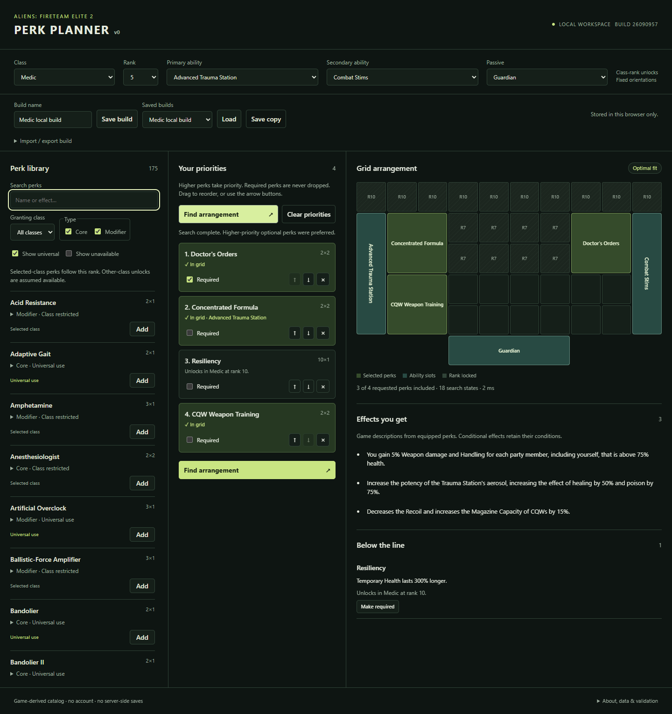

# Aliens: Fireteam Elite 2 perk planner

Build around the perks you care about. Choose your class and abilities, rank your perk priorities, and let the planner find an arrangement that fits the grid and its connection rules.

## What you can do

- **Prioritize your build.** Drag perks into order and mark must-have choices Required. Higher optional priorities take precedence over lower ones; the planner never adds unrequested filler.
- **Find an arrangement.** Fit fixed-orientation perks into rank-unlocked cells, respecting ability compatibility and connected groups. Modifiers can choose any compatible host or attach to one you select.
- **See what makes the cut.** Included perks are highlighted in your priority list. Read their equipped effects and see descriptions and reasons for choices left Below the line. Hover or focus to link a perk across the list, grid, and effects.
- **Explore the catalog.** Search perk names and descriptions; filter by granting class, Core/Modifier type, and universal use. Select class, rank, and ability variants to compare builds.
- **Keep and share builds.** Save named builds in your browser, or copy/paste and import/export JSON. Saves include priority order, Required flags, and host choices, including perks that did not fit.

The search runs in your browser, with a 60-second budget and cancellation. A completed search proves the best priority fit within the implemented model; a timed-out search reports its best result without claiming optimality. There are no accounts or server-side saves.

Try the five [Machinist validation builds](examples/machinist-validation/README.md) for oversized rank-10 priority lists and recorded reference layouts.

## Experimental fan project

**Largely vibe-coded with AI assistance. Use at your own risk.** Tests and limited manual checks do not guarantee correctness, security, or in-game accuracy. No support, maintenance, bug fixes, replies, data recovery, or future-patch compatibility are promised. Export builds you want to keep.

This unofficial tool is not affiliated with or endorsed by the game's developers, publishers, or rights holders. The catalog targets game build **26090957**, with 509 chip definitions, six classes, and seven board definitions. Fixed orientations are a planning assumption. Known selected-class grants follow rank; other-class and unknown/shared unlocks are assumed available. See [known limitations](docs/known-limitations.md), [support expectations](SUPPORT.md), and [game-data notices](NOTICE.md).

## Run locally

Use Node.js 22.14+ (CI uses Node 24) and the pnpm version pinned in package.json:

~~~sh
pnpm install --frozen-lockfile
pnpm dev
~~~

Open **http://127.0.0.1:4173/**. No installed game or extraction tools are needed. Keep the same browser and origin to retain saves; export/import JSON to move between localhost and a hosted site. Serve over HTTP(S), rather than opening index.html directly.

## Build and test

~~~sh
pnpm test
pnpm build
pnpm exec playwright install --with-deps chromium
pnpm test:e2e
~~~

The generated dist/ directory is ready for static hosting. It contains the app, worker, catalog, and license notices, with no application backend or runtime CDN dependency. For browser executable options and project-path checks, see [testing](docs/testing.md) and [recorded verification](docs/verification.md).

## GitHub Pages

The [Actions workflow](.github/workflows/pages.yml) tests pushes and pull requests, builds the site, and checks the production app under a project URL prefix. Successful default-branch runs deploy the tested artifact to Pages. Select **Settings → Pages → Build and deployment → Source: GitHub Actions** in the repository. See the [deployment guide](docs/deployment.md).

## License and documentation

Original code and project-authored documentation are [MIT licensed](LICENSE), copyright 2026 Corey O'Brien. Game-derived descriptions, names, trademarks, and other third-party material are outside that license grant; see [NOTICE.md](NOTICE.md).

The [documentation index](docs/README.md) covers architecture, the data pipeline, native rule evidence, portable builds, tests, and research history. Future coding agents should start with [AGENTS.md](AGENTS.md).
